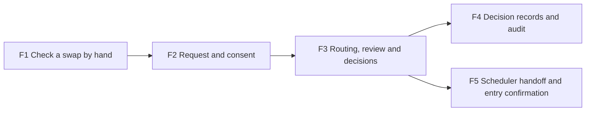

# Segmentation — ShiftSwap shift-swap pilot

| | |
| --- | --- |
| Source | `docs/design/requirements/shift-swap-pilot/prd.md`, version 0.3 (accepted 2026-11-15, Q16, Q25, Q26 open) |
| Status | **Approved by the Business Engineer, 2026-11-16 (Gate 1)**, with seams S1, S2 and S3 decided as recommended |
| Standing NFRs | `docs/design/quality/nfr-register.md`, owner Marcus Ellery (named in `AGENTS.md`, Non-functional requirements) |
| PRD-tier NFRs | None. The PRD states "Standing only". |
| Drafted by | Business Engineer agent, for the Business Engineer assigned by IT Applications (kickoff § 1.2) |

## Decisions already made by the Business Engineer (applied, not proposed)

1. Five features.
2. Group F is not a feature. Its notices go on the views they belong to.
3. H1's timestamps go to the features that create them.
4. Feature 1 is a standalone check an operator can use by hand: B1–B4, C1, F1, F2 and only the
   picking-and-result part of A1, including the refusal for shifts outside the pilot units. Four
   results: approved without review, review required, cannot be approved, cannot determine.
   "Approved without review" is a classification, not a stored approval. Nothing is stored and no
   consent is taken.
5. In Feature 1, B3 covers only conditions that need no stored requests. Each other B3 condition is
   assigned below to the later feature that first verifies it.
6. B5 belongs only to the feature that reaches a decision. C2–C6 stay with routing.
7. Only Feature 1 goes further now. Features 2–5 are boundaries only.

## Sequence

F4 and F5 both depend on F3 and not on each other.

## Requirement allocation

Every PRD requirement is placed exactly once, except where a requirement is split; splits are named.

| PRD item | Feature | Note |
| --- | --- | --- |
| A1 (pick own shift + other's shift; result for both; refusal outside CDU/HCU) | F1 | BE decision 4 |
| A1 (submitting the request to the other employee; storing it) | F2 | |
| A2 | F2 | Handover is not a swap; no record |
| A3 | F2 | Consent and withdrawal |
| B1, B2 | F1 | B1 keeps the v0.2 all-windows behaviour until Q25 is answered |
| B3 — missing roster shift or qualification record | F1 | |
| B3 — missing or inconsistent `exportedAt` / `coverage` (incl. coverage that disagrees with kickoff § 3.2; PRD contradiction 11) | F1 | |
| B3 — horizon (both shifts, export site-local date through +15 days) | F1 | |
| B3 — export older than 26 hours | F1 | |
| B3 — request involving an employee or shift in another undecided request (kickoff § 3.7) | **F2 first verifies** | First feature that stores requests |
| B3 — overlay: approved-but-not-exported swaps applied on top of the export (kickoff § 3.7) | **F3 first verifies** | First feature that produces approved swaps |
| B3 — overlay: not applied again once an export shows both shifts (kickoff § 4.2) | **F5 first verifies** | Needs export confirmation (E2) |
| B3 — request involving an approved swap a later export contradicts (kickoff § 4.4) | **F5 first verifies** | With B6 |
| B4 | F1 | F3 must keep it true when it adds approval paths (regression guard, not a move) |
| B5 | F3 only | BE decision 6 |
| B6 | F5 | |
| C1 | F1 | Classification only |
| C2, C3, C4, C5, C6 | F3 | BE decision 6 |
| D1 — record for each decision, written by the feature that creates the decision (withdrawn: F2; approved / declined: F3) | F2, F3 | Seam S1 |
| D1 — cross-outcome completeness and append-only proof | F4 | Seam S1 |
| D2 | F4 | Identity-from-headers is used from F1 onward; the scheduler's list access is exercised in F5 |
| D3 | F4 | Also bound on every feature through NFR-PRIV-001 |
| E1, E2, E3, E4 | F5 | Tie rule (kickoff § 4.5) with E1/E3 |
| F1 (`exportedAt` + rostered-only notice) | Views: F1 result view, and any later view that shows a check result (F2 status, F3 review). Decision-record part: F4 (D1 already carries `exportedAt`) | Group F dissolved |
| F2 (pilot-scope / holdover notice) | Views: F1 request and result views, and any later request or result view (F2, F3) | Group F dissolved |
| H1 — request time | F2 | Created when the request is submitted |
| H1 — agreement time | F2 | Created when the counterparty agrees |
| H1 — decision time: withdrawn | F2 | Created on withdrawal |
| H1 — decision time: approved / declined | F3 | Created on decision |
| H1 / US10 — export of the timestamps for evaluation | F4 | Not a timestamp; placed with records — **see seam S2** |
| H2 (P2 timeline) | F3, as P2 | **See seam S3** |
| US1, US2 | F1 | |
| US3, US9 | F2 (US9 extended to decided states by C5 in F3) | |
| US4, US5, US8 | F3 | |
| US6, US10 | F4 | |
| US7 | F5 | |

## Feature boundaries

### F1 — Check a proposed swap by hand

- **Business justification.** VE-HSSE-STD-014 § 4.1 permits a swap only if each employee's resulting
  schedule meets § 3; supervisors say they do not calculate rest hours and cannot see the other
  unit's roster (`supervisor-interviews.md:41-44`). PRD Group B; underpins M-1 and M-2. It stands on
  its own: an operator can see, before asking anyone, whether a swap is approvable and why.
- **In.** A1 (pick part, incl. refusal outside CDU/HCU), B1, B2, B3 (four no-storage conditions), B4,
  C1, F1 and F2 notices on the request and result views. Identity from `X-Employee-Number` /
  `X-Roles`; locally through the development-only user switcher (`engineering-standard.md` § 8.3).
- **Result.** Exactly one of: approved without review · review required · cannot be approved ·
  cannot determine, with per-employee figures and each determining rule (§ reference). A pick
  involving a non-CDU/HCU shift is refused before evaluation with the reason shown.
- **Out.** Storage of any kind, consent, sending to the other employee, supervisor tasks, decision
  records, timestamps, the overlay, the undecided-request and contradicted-swap conditions, B5, B6.
- **Open items attached.** Q25 (B1). Tablet waiver (draft at sign-off).

### F2 — Request and consent

- **Business justification.** Swaps start as texts with no shared record; the standard requires both
  employees to agree (§ 4.1). PRD Group A; US3, US9. Every request received counts toward M-3
  (kickoff § 1.8), so requests must exist as records of their own.
- **In.** A1 (submit and store), A2, A3, US9 for the states this feature creates, H1 request /
  agreement / withdrawal times, B3 undecided-conflicting-request condition (first verified here),
  F1/F2 notices on its views.
- **Out.** Approval, routing, supervisor review, B5.
- **Open items attached.** Q16 (request times make it measurable). Seam S1 (withdrawal is a
  decision under D1).

### F3 — Routing, review and decisions

- **Business justification.** Cuts supervisor effort on swaps that need no review and shows the
  figures when review is required (PRD Group C; M-3; US4, US5, US8).
- **In.** C2–C6, B5 (only here), H1 approve/decline times, overlay applied on top of the export
  (first verified here), B4 kept true across every new approval path, C5 extends US9 to terminal
  states, F1/F2 notices on review views, H2 (P2, seam S3).
- **Out.** Scheduler list, confirmation, contradicted-swap handling.
- **Open items attached.** Q25 (re-check uses the same rule), Q26 (are review actions limited to the
  supervisor of an affected unit?). Seam S1.

### F4 — Decision records and audit

- **Business justification.** § 4.5 requires every swap decision recorded and kept three years; the
  near-miss record omitted who approved and what was checked
  (`near-miss-PA-NM-2026-0193.md:31-32`). PRD Group D; US6, US10.
- **In.** D1 (see S1), D2 (supervisor-only record access; operator refused; no auditor role), D3,
  the H1 timestamp export for evaluation (S2).
- **Out.** IT's auditor extract process (kickoff § 5.5; not part of the build). Any purge (kickoff
  § 5.6).
- **Open items attached.** Retention candidate; Q26 (the scheduler's role also opens records).

### F5 — Scheduler handoff and entry confirmation

- **Business justification.** 7 of 41 approved swaps were not entered before the shift
  (`supervisor-interviews.md:24`); ShiftSwap cannot write to the roster. PRD Group E; M-4; US7.
- **In.** E1–E4, tie rule (kickoff § 4.5), the scheduler's list access under `shift-supervisor`
  (kickoff § 5.7), B6, overlay not reapplied after confirmation, contradicted-swap condition (first
  verified here).
- **Out.** Any scheduler integration or write to the roster.
- **Open items attached.** Q26; PRD contradictions 9 and 10 (meaning of "a different change";
  whether a reverted entry clears the block).

## Seams decided by the Business Engineer

- **S1 — Where decision records are written. Decided: recommendation.** NFR-COMP-001 is standing and active: every
  state-changing business decision writes an append-only audit record. F2 creates one (withdrawal)
  and F3 creates two (approved, declined). If D1 lives only in F4, F2 and F3 cannot honestly carry
  NFR-COMP-001 as `mapped`, and `n/a` would be false.
  *Recommendation:* each feature writes the D1 record for the decisions it creates (as H1's
  timestamps are distributed); F4 keeps D2, D3, the cross-outcome completeness and append-only proof,
  and the evaluation export. *Alternative:* keep D1 whole in F4, sequence F4 between F2 and F3, and
  move the withdrawal record from F2 into F4.
- **S2 — The timestamp export (US10). Decided: F4.** Placed in F4 with the records. It could equally sit in F3,
  once all three times exist.
- **S3 — H2 (P2 timeline). Decided: F3, as P2.** Placed in F3 as P2, beside the supervisor's view of both employees'
  figures. It could be deferred beyond the pilot instead.

## NFR × segment attachment

PRD-tier NFRs: none. All seven standing NFRs are `active` (no `Status` key) and apply to every
feature by default. The column values are proposed applicability; the formal disposition is set at
each feature's sign-off. No segment exists to hold an NFR.

| NFR | Proving layer · stage | F1 | F2 | F3 | F4 | F5 |
| --- | --- | --- | --- | --- | --- | --- |
| NFR-PRIV-001 No personal data in logs | integration · task | applies | applies | applies | applies (D3 home) | applies |
| NFR-COMP-001 Append-only audit record | integration · task | likely `n/a` — nothing stored, no state-changing decision | applies (withdrawal; S1) | applies (approve, decline; S1) | applies | applies if confirmation / attention mark are business decisions — settle at F5 sign-off |
| NFR-A11Y-001 axe-core zero violations per view | static-analysis · task | applies | applies | applies | applies (record view) | applies |
| NFR-PERF-001 p95 ≤ 500 ms at 2 req/s | load/performance · feature-verification | applies — Blocked, no staging | same | same | same | same |
| NFR-REL-001 99.5 % monthly availability | live-procedure · operations | applies — production not provisioned | same | same | same | same |
| NFR-COMPAT-001 Edge current/previous | live-procedure · feature-verification | applies | applies | applies | applies | applies |
| NFR-COMPAT-002 Safari on iPadOS | live-procedure · feature-verification | applies; waiver proposed (kickoff § 5.4), **unsigned** | same | same | same | same |

## Open items carried (not resolved here)

| Item | What is open | Owner | Attached to |
| --- | --- | --- | --- |
| Q16 | How many requests arrive around a shift change; unknown until the pilot records it (kickoff § 1.7) | Renee Landry, Carl Nguyen *(proposed)* | F2 (request times), F4 (export) |
| Q25 | Should an existing breach in a window or rest period the swap does not change stop the swap? B1 keeps the v0.2 all-windows behaviour until answered | Simone Arceneaux | F1, F3 |
| Q26 | The scheduler's `shift-supervisor` role also opens decision records and supervisor views; are review actions limited to an affected unit's supervisor? | Marcus Ellery; Simone Arceneaux | F3, F4, F5 |
| Tablet waiver (NFR-COMPAT-002) | Terms in kickoff § 5.4; needs the Business Engineer's and Marcus Ellery's signatures; none recorded. A waiver is recorded per feature, so whether F2–F5 each need a signed copy is also open | Business Engineer; Marcus Ellery | Every feature; first drafted at F1 |
| Retention candidate | Three-year retention (`fatigue-management-policy.md` § 4.5) is in no standing record; Marcus will add one at the register's next revision (kickoff § 5.6), date not stated. Until then: never delete a record; no purge. Agents propose; only the register owner writes the register | Marcus Ellery | F4, and each feature that writes records (S1) |

## Segmentation check (`neo-nfr-authoring` § 9)

- Every PRD NFR attached to a segment: vacuous — the PRD has none ("Standing only").
- No segment exists only to hold an NFR: met.
- Every segment carries its own business justification: met, with the sources cited above.
